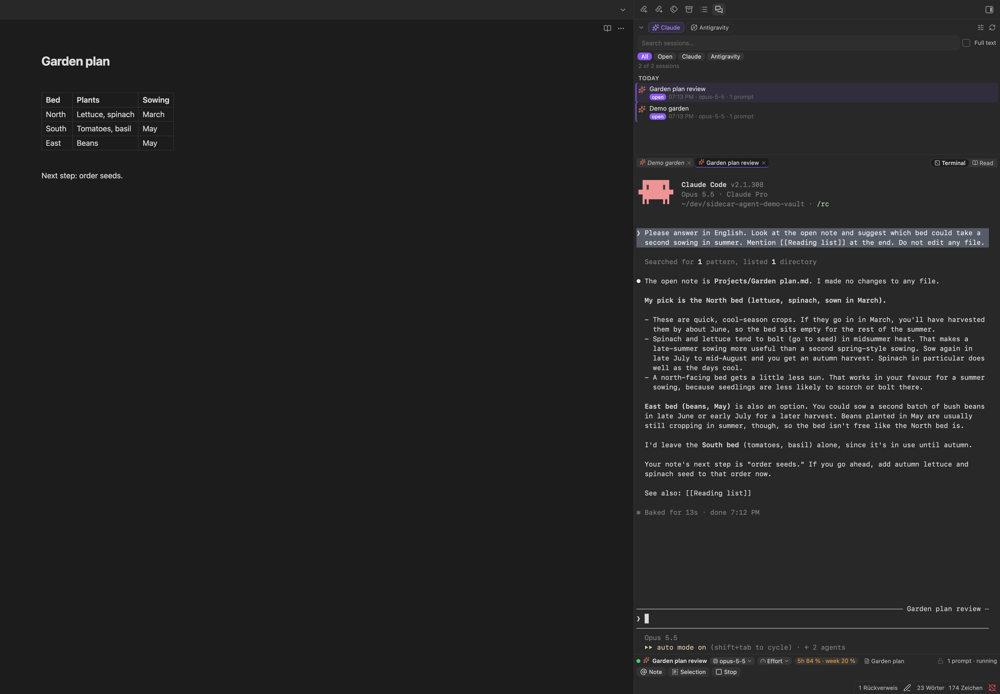
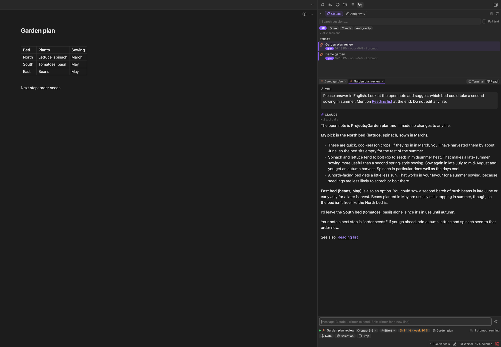

# Sidecar Agent

Run [Claude Code](https://docs.claude.com/en/docs/claude-code) and [Antigravity](https://antigravity.google) in a real terminal in Obsidian's right sidebar, right next to your notes.

Sidecar Agent does not reimplement the agents. It starts the official command-line tools in a real pseudo-terminal, so everything works exactly as in your terminal app: slash commands, `/model`, permission prompts, `@` file completion, hooks, status lines and Remote Control. Around that terminal it adds what is missing in a sidebar: a searchable session list, a reading view and a few conveniences for working with notes.

## Features

- **Real terminal sessions** for Claude Code (`claude`) and Antigravity (`agy`), several in parallel as tabs.
- **Session list** of every session started in this vault, grouped by day, with quick search and optional full-text search through the complete history. Click to resume, right-click to fork, rename or resume with another model.
- **Reading view** for Claude sessions: the conversation rendered like a note, with Obsidian's Markdown, tables, code blocks and **clickable wikilinks**. Updates live while Claude works and has its own input field.

- **Model and effort per session.** The chips below the terminal switch the model or effort of this session only, without changing your global Claude default. The session restarts with its history kept.
- **Note context.** Optionally, every Claude message silently carries the path of the note you are looking at (and a selection in it), so you can just ask "summarize this". Toggle it with one click.
- **Usage limits** of your Claude plan (5-hour and weekly window) and of Antigravity's model groups, shown below the terminal.
- **Resume after the usage limit.** When a Claude session hits the limit, Sidecar Agent sends a short message after the reset so the task continues. Claude Code does not do this by itself in sessions with Remote Control.
- **Send notes and selections** to a session from the editor, the file explorer, by drag and drop or with commands.
- **Focus lock** (optional) keeps the keyboard focus in the terminal, handy for dictation tools that type into the focused window.
- Calm terminal colors that follow your Obsidian theme and accent color.
- English and German interface.

## Requirements

- **macOS** (Sidecar Agent is desktop only and has been tested on macOS only. It does not work on Windows.)
- **Python 3** at `/usr/bin/python3` or from Homebrew. It runs the small pseudo-terminal helper. On a fresh Mac, `/usr/bin/python3` asks to install the Command Line Tools on first use.
- **Claude Code** (`claude`) and/or the **Antigravity CLI** (`agy`), installed and logged in. Sidecar Agent looks for them in `~/.local/bin`, `~/bin`, `/opt/homebrew/bin`, `/usr/local/bin` and `/usr/bin`, or uses the path you set in the settings.
- An account for the agent you use: a Claude subscription or API access for Claude Code, a Google account for Antigravity. Sidecar Agent itself needs no account.
- Optional: [ripgrep](https://github.com/BurntSushi/ripgrep) (`brew install ripgrep`) makes the full-text search faster.

## Installation

In Obsidian, open **Settings → Community plugins → Browse**, search for "Sidecar Agent", install and enable it. The panel opens in the right sidebar. Use the ribbon icon or the command **Sidecar Agent: Open panel** to bring it back.

Manual installation: download `main.js`, `manifest.json` and `styles.css` from the [latest release](https://github.com/manuelniehues/obsidian-sidecar-agent/releases/latest) into `<vault>/.obsidian/plugins/sidecar-agent/` and enable the plugin.

## Usage

| What | How |
|---|---|
| New session | **Claude** or **Antigravity** button at the top. The sliders button opens a dialog with agent, model, effort, name, first message and the current note. |
| Resume | Click a session in the list. If it is already open, the panel just switches to it. |
| More actions | Right-click a session: resume, fork (Claude), resume with another model, rename, copy ID. Right-click a tab: rename, restart, close. |
| Type | Directly in the agent's prompt line in the terminal. Shift+Enter adds a new line. |
| Reading view | **Read** switch above the terminal. Enter sends, Shift+Enter adds a line, Escape in the empty field interrupts Claude. Menus and permission prompts appear only in the terminal. |
| Note or selection | **Note** / **Selection** buttons below the terminal, the editor or file context menu, or drag a file into the terminal. The text lands in the prompt line without being sent. |
| Model / effort | Chips below the terminal. The switch applies to this session only. |
| Stop | **Stop** button or Esc in the terminal. |

Keyboard shortcuts in the terminal: Shift+Enter new line, ⌘C copy selection, ⌘K clear, ⌥←/→ word left/right, ⌘←/→ line start/end, ⌘⌫ delete line. Other ⌘ shortcuts stay with Obsidian. Option stays a character key, so `@`, `[`, `]`, `{`, `}`, `|`, `\` and `~` work on layouts that need Option for them.

## Privacy, network use and files outside the vault

Sidecar Agent itself sends nothing over the network and contains no telemetry. It starts `claude` and `agy` on your computer. **These programs talk to Anthropic's and Google's servers** under your account and their own terms, exactly as when you run them in a terminal.

Like the agents themselves, the plugin works with files outside your vault:

| Path | Access | Why |
|---|---|---|
| `~/.claude/projects/<vault>/*.jsonl` | read, append | Claude Code's session files of this vault, for the session list, search and the reading view. When you rename a session, the name is appended like `/rename` does. |
| `~/.claude/themes/sidecar-agent.json` | write | The muted color scheme for plugin sessions (setting "Color scheme"). Not written when you choose Claude's own colors. |
| `~/.gemini/antigravity-cli/` | read only | Antigravity's conversation list and last chosen model. |
| `~/Library/Caches/sidecar-agent/` | write | Session index, Claude usage limits, the current note context (one file per vault). |
| `~/Library/Application Support/sidecar-agent/` | write | Two small Python scripts that Claude runs in plugin sessions: the status line (reads your usage limits) and the note-context hook. |

Your global `~/.claude/settings.json` is never changed. Plugin sessions get their status line, hook, color scheme and `autoContinueAtUsageLimit` through `--settings`, which applies to that process only.

The note context sends only the **path** of the open note and a selection you made. The agent reads the note itself, like any other file in the vault it has access to.

## Settings worth knowing

- **Permission mode** (Claude) and **Allow tool calls automatically** (Antigravity, off by default) decide how much the agent may do without asking. Sidecar Agent passes them through and does not add any sandbox of its own. Agents can change and delete files in your vault, so keep backups.
- **Remote Control**: with Claude's `remoteControlAtStartup` or the setting "Always on", plugin sessions show up in the Claude app on your phone.
- **Resume after usage limit** is on by default and can be turned off or given your own message.

## Known limitations

- macOS only. Linux may work but is untested, Windows does not work.
- The reading view is available for Claude sessions only. Antigravity stores its history in a binary format.
- The session list shows sessions started in this vault (the vault folder is the working directory).
- Automatic resume needs Obsidian and the session to stay open.
- Do not resume a conversation in the panel while it is still open in a terminal. Sidecar Agent detects this for Claude and refuses to start.

## Support

Sidecar Agent is a personal project, shared as is. There is **no support**: issues are disabled and questions will not be answered. New versions appear whenever the plugin improves in daily use. If you want to change something, fork it under the MIT license.

## Credits

The terminal is [xterm.js](https://xtermjs.org) (MIT license, Copyright (c) The xterm.js authors), bundled with its fit, unicode11, web-links and webgl add-ons.

Sidecar Agent is not affiliated with Anthropic, Google or Obsidian.

## License

[MIT](./LICENSE) © Manuel Niehues
